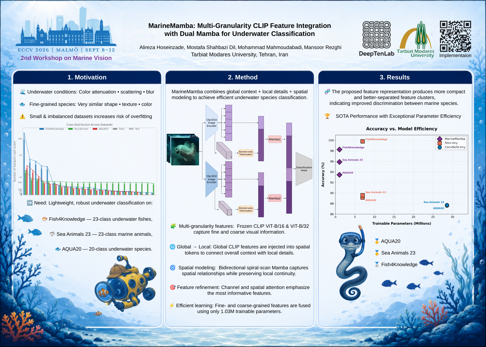

# MarineMamba: Multi-Granularity CLIP Feature Integration with Dual Mamba for Underwater Classification

**Alireza Hoseinzade, Mostafa Shahbazi Dil, Mohammad Mahmoudabadi, Mansoor Rezghi**  
Tarbiat Modares University, Tehran, Iran  
**2nd Workshop on Marine Vision · ECCV 2026**

[Paper](https://openreview.net/forum?id=rCrRa9yBDQ) · [Poster](docs/poster.pdf) · [Quick start](#quick-start) · [Results](#results) · [Citation](#citation) · [License](#license)

MarineMamba is a dual-branch state-space model for aquatic and marine species classification. It combines frozen CLIP spatial features at two resolutions with CLIP feature vectors, and trains **1.03 million parameters** in the downstream branches and classification head. The frozen CLIP encoders are additional to this trainable parameter count.

The repository documents experiments on **AQUA20**, **Sea Animals 23**, and **Fish4Knowledge**, including multi-seed results, component ablations, and a Vim-tiny baseline.

<!-- Author and workshop information is transcribed from the supplied poster. Confirm the citation against the official publication record before adding any proceedings details or DOI. -->

## Contents

- [Architecture](#architecture)
- [Results](#results)
- [Quick start](#quick-start)
- [Datasets](#datasets)
- [Experiments and reproducibility](#experiments-and-reproducibility)
- [Ablation study](#ablation-study)
- [Project layout](#project-layout)
- [Feature cache format](#feature-cache-format)
- [Poster](#poster)
- [Citation](#citation)
- [License](#license)

## Architecture

[](docs/poster.pdf)

| Branch | Spatial feature shape | CLIP feature vector | Branch output |
| --- | --- | --- | --- |
| Fine, ViT-B/16 | 768 × 14 × 14 | 512 dimensions | 128 dimensions |
| Coarse, ViT-B/32 | 768 × 7 × 7 | 512 dimensions | 128 dimensions |

**MarineMambaBlock** — the core building block:
- LayerNorm → SpiralScanner reorders spatial tokens (outside-in and center-out)
- CLIP Feature Vector prepended to each spiral sequence before Mamba runs
- Bidirectional Mamba pass (forward spiral + backward spiral) with a learnable fusion gate
- CBAM channel-and-spatial attention applied to the spatial output
- LayerScale + DropPath residual for stable deep training

**Why spiral scanning?** The model uses outside-in and center-out spiral traversals to order spatial tokens for Mamba. The scan-order ablation below compares this design with raster scanning.

**MLP Head:** LayerNorm(256) → Linear(256→512) → GELU → Dropout(0.3) → Linear(512→C)

| Component | Trainable params |
|-----------|--------|
| Fine branch (ViT-B/16, 14×14) | 0.453 M |
| Coarse branch (ViT-B/32, 7×7) | 0.434 M |
| MLP head | 0.144 M |
| **Total** | **1.031 M** |

Parameter counts in this table cover the downstream model; they exclude both frozen CLIP encoders and do not describe end-to-end feature-extraction cost.

## Results

Results reported in this repository. MarineMamba: 11 seeds (0–9 + 42). Vim-tiny baseline: 5 seeds (0–4). Values with uncertainty are mean ± standard deviation across seeds.

**Comparison notes:** MarineMamba parameter counts refer to trainable downstream parameters and exclude frozen CLIP encoders. External baseline values below are retained from the original README; source references and matching evaluation protocols must be documented before treating them as directly comparable.

### AQUA20 — 20 aquatic species

| Method | Reported params | Top-1 Acc |
|--------|--------|-----------|
| ResNet-50 (fine-tuned) | 25 M | ~92% |
| EfficientNet-B4 | 19 M | ~93% |
| Vim-tiny (fine-tuned, 5 seeds) | 6.96 M | 89.50 ± 0.46% |
| **MarineMamba (ours)** | **1.03 M** | **93.46 ± 0.57%** |

### Sea Animals 23 — 23 sea species

| Method | Reported params | Top-1 Acc |
|--------|--------|-----------|
| Standard CNN (public baseline) | — | 88.77% |
| Vim-tiny (fine-tuned, 5 seeds) | 6.96 M | 89.71 ± 0.33% |
| **MarineMamba (ours)** | **1.03 M** | **95.90 ± 0.80%** |

### Fish4Knowledge — 23 fish species (raw imbalanced split, ratio 1100:1)

| Method | Split | Top-1 Acc |
|--------|-------|-----------|
| Multi-level ResVGGNet [2021] | balanced | 99.69% |
| Vim-tiny (fine-tuned, 5 seeds) | imbalanced | 99.79 ± 0.01% |
| **MarineMamba (ours)** | **imbalanced** | **98.25 ± 0.26%** |

> The ResVGGNet result is reported on a curated balanced split, while the MarineMamba and Vim-tiny experiments above use an imbalanced split. These are different evaluation settings; their accuracies should not be treated as a direct comparison. Vim-tiny has higher reported top-1 accuracy than MarineMamba on the imbalanced Fish4Knowledge split.

<!-- Add primary references for ResNet-50, EfficientNet-B4, the Sea Animals 23 public baseline, and ResVGGNet. State dataset versions, split construction, and model-selection protocol. -->

## Quick Start

**Requirements:** CUDA GPU (mamba-ssm requires CUDA), Python >= 3.10.

```bash
git clone https://github.com/alirezahos78/MarineMamba.git
cd MarineMamba
python -m venv .venv
source .venv/bin/activate
pip install -r requirements.txt
```

### AQUA20

```bash
# 1. Download dataset (~300 MB → data/aqua20/)
python3 scripts/download_aqua20.py

# 2. Extract CLIP features (run once, ~15 min on GPU)
python3 scripts/build_clip_features.py

# 3. Train across 11 seeds and report mean ± std
python3 main.py --configs aqua20_dual_hybrid_128_focal_balanced
```

### Sea Animals 23

```bash
# 1. Prepare 80/20 split from the downloaded flat directory
python3 scripts/prepare_sea23.py --src data/sea23_raw --dst data/sea23

# 2. Extract CLIP features
python3 scripts/build_clip_features.py \
    --aqua20-root data/sea23 \
    --out-b16 data/sea23_clip_vit_b16_spatial_grid_aug \
    --out-b32 data/sea23_clip_vit_b32_spatial_grid_aug \
    --out-cls data/sea23_dual_clip_pooled_features.pt

# 3. Train
python3 main.py --configs sea23_dual_hybrid_128_focal_balanced
```

### Fish4Knowledge

```bash
# 1. Download and split (~500 MB → data/fish4k/)
python3 scripts/download_fish4k.py

# 2. Extract CLIP features
python3 scripts/build_clip_features.py \
    --aqua20-root data/fish4k \
    --out-b16 data/fish4k_clip_vit_b16_spatial_grid_aug \
    --out-b32 data/fish4k_clip_vit_b32_spatial_grid_aug \
    --out-cls data/fish4k_dual_clip_pooled_features.pt

# 3. Train
python3 main.py --configs fish4k_dual_hybrid_128_focal_balanced
```

### All three datasets in one run

```bash
python3 main.py --configs \
    aqua20_dual_hybrid_128_focal_balanced \
    sea23_dual_hybrid_128_focal_balanced \
    fish4k_dual_hybrid_128_focal_balanced
```

<!-- Add the tested Python, PyTorch, CUDA, and mamba-ssm versions and reference GPU. Runtime and download-size estimates above are inherited from the original README. -->

## Datasets

| Dataset | Classes | Preparation entry point |
| --- | --- | --- |
| AQUA20 | 20 | `scripts/download_aqua20.py` |
| Sea Animals 23 | 23 | Download the raw images, then run `scripts/prepare_sea23.py`; the documented split is 80/20 stratified |
| Fish4Knowledge | 23 | `scripts/download_fish4k.py`; the reported experiment preserves class imbalance |

See the dataset-specific commands in [Quick Start](#quick-start).

<!-- Add official dataset/download links, dataset terms, exact train/validation/test counts, split seeds or manifests, and the source for the Sea Animals 23 raw download. Do not invent a validation split if none was used. -->

## Experiments and Reproducibility

The following sections provide the documented commands for custom seeds, ablations, baseline training, and visualizations.

| Experiment | Documented seeds | Summary output |
| --- | --- | --- |
| MarineMamba main results | 0–9 and 42 | `results.json` |
| AQUA20 ablations | 0, 1, 2 | `ablation_results.json` |
| Vim-tiny baseline | 0–4 | `results_vim_{dataset}.json` |

<!-- Complete docs/reproducibility.md with dataset splits, tested environment, hardware, hyperparameters, checkpoint-selection rules, and the command/configuration corresponding to each paper table. Add verified checkpoint links if weights are released. -->

## Custom Seeds

```bash
python3 main.py --configs aqua20_dual_hybrid_128_focal_balanced --seeds 0 1 2 3 4
```

Output after all seeds finish:
```
  aqua20_dual_hybrid_128_focal_balanced
    Mean ± Std : 93.46 ± 0.57%
    Variance   : 0.3216
```

Results are also written to `results.json`.

## Ablation Study

AQUA20, seeds 0, 1, and 2. These use a different seed set from the 11-seed main results. Deltas are **percentage points (pp)** relative to the full model.

### Scan order

| Variant | Top-1 Acc | Δ vs Full (pp) |
|---------|-----------|-----------|
| **Spiral (ours)** | **93.44 ± 0.13%** | — |
| Raster | 92.91 ± 0.82% | −0.53 |

### Model components

| Variant | Top-1 Acc | Δ vs Full (pp) |
|---------|-----------|-----------|
| **Full model (spiral)** | **93.44 ± 0.13%** | — |
| Coarse branch only (B/32) | 93.34 ± 0.51% | −0.10 |
| Fine branch only (B/16) | 92.29 ± 0.93% | −1.15 |
| No focal loss (CE only) | 92.83 ± 0.96% | −0.61 |
| No Mamba (FFN only) | 85.98 ± 0.44% | −7.46 |
| No CLIP Feature Vector injection | 85.07 ± 0.61% | −8.37 |

> Across these three seeds, the full model has a 0.10 pp higher mean accuracy and a lower observed standard deviation than the coarse-only variant. Removing Mamba or CLIP feature-vector injection produces the largest observed drops, exceeding 7 pp. These descriptive results alone do not establish statistical significance.

## Ablation Scripts

```bash
# All variants (AQUA20, seeds 0 1 2)
python3 scripts/ablation.py

# Specific variants only
python3 scripts/ablation.py --variants spiral raster
python3 scripts/ablation.py --variants no_mamba no_cls --seeds 0 1 2
```

Available variants: `spiral`, `raster`, `no_focal_loss`, `no_mamba`, `no_cls`, `fine_only`, `coarse_only`.

Results are written to `ablation_results.json`.

## UMAP Visualisation

```bash
# 6-panel UMAP for any dataset (train + test)
python3 scripts/umap_vis.py --config aqua20_dual_hybrid_128_focal_balanced --seed 4
python3 scripts/umap_vis.py --config sea23_dual_hybrid_128_focal_balanced --seed 3
python3 scripts/umap_vis.py --config fish4k_dual_hybrid_128_focal_balanced --seed 9
```

Panels: CLIP B/16 · CLIP B/32 · Mamba fine branch · Mamba coarse branch · Concat · Raw images.

## Vim-tiny Baseline

Evaluates pretrained Vim-tiny (ImageNet-1k, 76.1% top-1) with full fine-tuning. MarineMamba uses frozen CLIP encoders, so the methods differ in pretraining and in which parameters are updated. Also saves the best checkpoint per seed and computes macro-F1 / weighted-F1 from the checkpoint.

**Citation:** Zhu et al., "Vision Mamba: Efficient Visual Representation Learning with Bidirectional State Space Model", ICML 2024. [arXiv:2401.13586](https://arxiv.org/abs/2401.13586)

Full fine-tune of all 6.96M params (lr=5e-5, cosine+warmup, patience=20, CE+label_smoothing=0.1).

```bash
# Single dataset
python3 scripts/baseline_vim.py --datasets aqua20 --seeds 0 1 2 3 4

# All three datasets in one run
python3 scripts/baseline_vim.py --seeds 0 1 2 3 4

# Specific seeds / datasets
python3 scripts/baseline_vim.py --datasets fish4k --seeds 3 4
```

Outputs per dataset:
- `results_vim_{dataset}.json` — top-1 summary (mean ± std across seeds)
- `results/vim_{dataset}_f1.json` — full metrics (macro-F1, weighted-F1, precision, recall)
- `results/best_model_vim_{dataset}_seed_{N}.pth` — best checkpoint per seed

Resumes automatically: if a checkpoint exists for a seed, training is skipped and only evaluation runs.

## Confusion Matrix

```bash
python3 scripts/confusion_matrix.py --config aqua20_dual_hybrid_128_focal_balanced --seed 4 --save-png
```

## Project Layout

The source modules and commands below follow the supplied repository documentation. Generated data and logs are not tracked by Git.

| Path | Purpose |
| --- | --- |
| `main.py` | Training entry point across experiment configurations and seeds |
| `requirements.txt` | Python dependencies |
| `marinemamba/model.py` | MarineMamba, MarineMambaBlock, SpiralScanner, and CBAM |
| `marinemamba/trainer.py` | Training, multi-seed orchestration, and checkpointing |
| `marinemamba/config.py` | Named experiment configurations |
| `marinemamba/data.py` | Feature dataset and data loaders |
| `marinemamba/losses.py` | Loss functions |
| `marinemamba/paths.py` | Filesystem paths |
| `marinemamba/utils.py` | Logging, random seeds, and directory helpers |
| `scripts/` | Dataset preparation, feature extraction, ablation, baseline, and visualization commands |
| `results.json` | Main training results |
| `ablation_results.json` | Scan-order and component-ablation results |
| `results_vim_{dataset}.json` | Vim-tiny top-1 summaries |
| `results/` | Evaluation metrics and checkpoint outputs described below |
| `data/` | Raw images and feature caches; generated locally |
| `logs/` | Per-seed logs and plots; generated locally |
| `docs/poster.pdf` | Workshop poster |
| `assets/poster-preview.png` | Poster preview used in this README |
| `CITATION.cff` | Machine-readable citation metadata |
| `LICENSE` | MIT license |

<!-- Suggested future documentation additions: docs/reproducibility.md, results/README.md. Keep current output paths until any code references have been checked. -->

## Feature Cache Format

Features are extracted once and cached as `.pt` files. Training loads directly from caches — raw images are not needed at train time.

| File | Contents |
|------|----------|
| `*_clip_vit_b16_spatial_grid_aug/train_features.pt` | B/16 patches [768, 14, 14], 4 views/image |
| `*_clip_vit_b32_spatial_grid_aug/train_features.pt` | B/32 patches [768, 7, 7], 4 views/image |
| `*_clip_vit_b16_spatial_grid_aug/test_features.pt`  | B/16 patches, 1 view/image (clean) |
| `*_clip_vit_b32_spatial_grid_aug/test_features.pt`  | B/32 patches, 1 view/image (clean) |
| `*_dual_clip_pooled_features.pt` | CLIP Feature Vectors for B/16 and B/32 (clean, 1 view) |

The `aug` suffix means 3 augmented crops are extracted per training image at build time (random resized crop, color jitter, horizontal flip, grid-shuffle), giving 4 views per image total.

## Poster

[Download the poster (PDF)](docs/poster.pdf), presented at the **2nd Workshop on Marine Vision, ECCV 2026**.

## Citation

If you use MarineMamba in your research, please cite the [paper on OpenReview](https://openreview.net/forum?id=rCrRa9yBDQ).

```bibtex
@inproceedings{hoseinzade2026marinemamba,
  title     = {{MarineMamba}: Multi-Granularity {CLIP} Feature Integration with Dual {Mamba} for Underwater Classification},
  author    = {Hoseinzade, Alireza and Shahbazi Dil, Mostafa and Mahmoudabadi, Mohammad and Rezghi, Mansoor},
  booktitle = {2nd Workshop on Marine Vision},
  year      = {2026},
  note      = {ECCV 2026 workshop},
  url       = {https://openreview.net/forum?id=rCrRa9yBDQ}
}
```

Citation metadata is also provided in [`CITATION.cff`](CITATION.cff).

<!-- Bibliographic fields above are based on the supplied poster and paper URL, not an exported publisher/OpenReview citation. Confirm official venue wording; add DOI, pages, or proceedings identifiers only after verification. -->

## License

This repository is licensed under the [MIT License](LICENSE). Dataset and pretrained-model terms should be checked at their respective sources.
